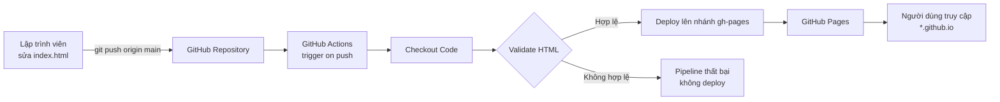

# DevOps Lab 1 — Portfolio CI/CD

[](https://github.com/vuanhmin/devops-lab1-portfolio/actions/workflows/deploy.yml)
[](https://vuanhmin.github.io/devops-lab1-portfolio/)
[](https://github.com/vuanhmin/devops-lab1-portfolio)

> **Lab 1 — Tổng quan về Vận hành & Bảo trì Phần mềm**
> Trải nghiệm quy trình DevOps end-to-end: **Plan → Code → Build → Test → Deploy → Monitor**

---

## Thông tin dự án

| Hạng mục | Nội dung |
|-----------|----------|
| **Website** | https://vuanhmin.github.io/devops-lab1-portfolio/ |
| **Repository** | https://github.com/vuanhmin/devops-lab1-portfolio |
| **Pipeline** | [`.github/workflows/deploy.yml`](.github/workflows/deploy.yml) |
| **Nhánh triển khai** | `main` (nguồn) → `gh-pages` (GitHub Pages) |
| **Công nghệ** | HTML5, CSS3, Git, GitHub Actions, GitHub Pages |
| **Trạng thái** | Tự động build và deploy mỗi lần push lên `main` |

---

## 1. Mục tiêu

Sau bài lab này, dự án đáp ứng được các mục tiêu sau:

- Trải nghiệm đầy đủ vòng đời DevOps trên một dự án thật.
- Xây dựng pipeline CI/CD bằng GitHub Actions, không cần server riêng.
- Deploy website tĩnh lên GitHub Pages và có URL công khai.
- Hiểu sự khác biệt giữa deploy thủ công và deploy tự động.
- Biết cách rollback và theo dõi trạng thái pipeline.

---

## 2. Cấu trúc dự án

```text
devops-lab1-portfolio/
├── .github/
│   └── workflows/
│       └── deploy.yml      # Định nghĩa pipeline CI/CD
├── screenshots/            # Ảnh chụp minh chứng nộp bài
│   └── README.md
├── .nojekyll               # Tắt xử lý Jekyll của GitHub Pages
├── index.html              # Website portfolio tĩnh
└── README.md               # Tài liệu dự án
```

---

## 3. Vòng đời DevOps trong bài lab

| Giai đoạn | Công cụ / Cách thực hiện |
|-----------|---------------------------|
| **Plan** | Xác định yêu cầu và tiêu chí chấm điểm của Lab 1 |
| **Code** | Viết `index.html` bằng HTML5/CSS3, quản lý bằng Git |
| **Build** | GitHub Actions checkout source code trên runner Ubuntu |
| **Test** | Kiểm tra `index.html` tồn tại, có `DOCTYPE`, có thẻ đóng `</html>` |
| **Deploy** | `peaceiris/actions-gh-pages` publish website lên nhánh `gh-pages` |
| **Monitor** | Theo dõi log, trạng thái từng step trong tab **Actions** |

Sơ đồ workflow:



Luồng thực tế:

```text
Push code (main)
      |
      v
GitHub Actions
      |
      +--> Checkout Code
      +--> Validate HTML
      +--> Deploy to gh-pages
                  |
                  v
           GitHub Pages (live)
```

---

## 4. Pipeline CI/CD

### 4.1 Khi nào pipeline chạy?

Pipeline được kích hoạt khi:

- Có commit được push lên nhánh `main`.
- Chạy thủ công từ GitHub UI bằng nút **Run workflow** (`workflow_dispatch`).

### 4.2 Các bước trong pipeline

| Step | Việc thực hiện |
|------|----------------|
| `Checkout Code` | Lấy source code từ repository về runner |
| `Validate HTML` | Kiểm tra file, thẻ HTML cơ bản và placeholder còn sót |
| `Deploy to GitHub Pages` | Publish toàn bộ website lên nhánh `gh-pages` |

### 4.3 Quyền của pipeline

Workflow khai báo:

```yaml
permissions:
  contents: write
```

Quyền này cần thiết để `GITHUB_TOKEN` có thể tạo/cập nhật nhánh `gh-pages`.

### 4.4 Phiên bản action

Pipeline sử dụng các phiên bản còn tương thích với GitHub Actions runner hiện tại:

- `actions/checkout@v7`
- `peaceiris/actions-gh-pages@v4`

> **Lưu ý:** Tài liệu lab gốc sử dụng `actions/checkout@v4` và `peaceiris/actions-gh-pages@v3`. Từ ngày **23/09/2026**, Node.js 20 đã bị gỡ khỏi GitHub Actions runner, nên các action cũ chạy trên Node 20 có thể lỗi. Dự án dùng `checkout@v7` và `actions-gh-pages@v4` (Node 24) để pipeline chạy ổn định.

---

## 5. Hướng dẫn deploy lần đầu

### Bước 1 — Push code lên nhánh main

```bash
git add .
git commit -m "feat: complete DevOps Lab 1 portfolio + CI/CD pipeline"
git push origin main
```

### Bước 2 — Chờ pipeline chạy

1. Mở repository trên GitHub.
2. Chọn tab **Actions**.
3. Chọn workflow **Deploy to GitHub Pages**.
4. Chờ cả 3 step chuyển sang trạng thái thành công.

Sau lần chạy đầu tiên, GitHub Actions sẽ tự tạo nhánh `gh-pages`.

### Bước 3 — Bật GitHub Pages

1. Vào **Settings** → **Pages**.
2. Mục **Build and deployment** → **Source**: chọn **Deploy from a branch**.
3. **Branch**: chọn `gh-pages` → thư mục `/ (root)`.
4. Bấm **Save**.
5. Chờ 1–2 phút, GitHub hiển thị URL:

```text
https://vuanhmin.github.io/devops-lab1-portfolio/
```

> Nếu chưa thấy nhánh `gh-pages`, hãy quay lại bước 2 và chờ pipeline chạy xong.

---

## 6. Quy trình cập nhật website

Mỗi lần muốn thay đổi nội dung website:

```bash
# 1. Sửa index.html trên nhánh main
# 2. Commit và push
git add index.html
git commit -m "update: thay doi noi dung website"
git push origin main
```

GitHub Actions sẽ tự động:

1. Checkout code mới.
2. Validate HTML.
3. Deploy phiên bản mới lên `gh-pages`.
4. Cập nhật website sau khoảng 10–30 giây.

> **Không chỉnh sửa trực tiếp nhánh `gh-pages`.** Nhánh này là bản build tự động và sẽ bị ghi đè trong lần deploy tiếp theo.

---

## 7. Chạy website ở máy local

Mở trực tiếp file `index.html` bằng trình duyệt:

```bash
# Windows
start index.html

# macOS
open index.html

# Linux
xdg-open index.html
```

Hoặc chạy một web server tĩnh:

```bash
npx serve .
```

Sau đó mở địa chỉ mà `serve` hiển thị (thường là `http://localhost:3000`).

---

## 8. So sánh DevOps và cách làm truyền thống

| Tiêu chí | Cách THỦ CÔNG (Traditional) | Cách DEVOPS (CI/CD Pipeline) |
|----------|-----------------------------|------------------------------|
| **Làm sao để deploy?** | Mở FTP/SSH, upload file lên server, cấu hình web server bằng tay | Push code lên `main` → pipeline tự chạy |
| **Mất bao lâu?** | Khoảng 15–30 phút, tùy số file và cấu hình | Khoảng 10–30 giây |
| **Ai làm deploy?** | Lập trình viên hoặc quản trị viên tự thao tác | GitHub Actions (máy tự làm) |
| **Có bị sai sót không?** | Dễ quên file, sai thư mục, sai quyền, cấu hình lệch giữa các lần | Không — pipeline chạy nhất quán 100% |
| **Rollback nếu lỗi?** | Upload lại file cũ, dễ nhầm phiên bản | `git revert <commit>` + push → tự động deploy bản cũ |
| **Làm sao biết deploy thành công?** | Phải tự kiểm tra website và server | Tab Actions, log từng step, thông báo thành công/thất bại |
| **Lịch sử deploy** | Không có hoặc ghi chép thủ công | Lưu đầy đủ trong GitHub Actions và Git history |
| **Chi phí vận hành** | Cần server, thời gian công sức | Miễn phí với GitHub Actions và GitHub Pages |

---

## 9. Trả lời câu hỏi lab

### Câu 1: DevOps workflow tự động hóa những bước nào mà cách thủ công phải làm bằng tay?

GitHub Actions tự động hóa các bước:

- Lấy source code mới nhất từ repository.
- Kiểm tra file và cấu trúc HTML cơ bản.
- Tạo bản build tĩnh.
- Deploy lên nhánh `gh-pages` và cập nhật GitHub Pages.
- Ghi log, báo trạng thái thành công hoặc thất bại.

Cách thủ công phải tự upload file, cấu hình server, kiểm tra website và ghi chép lại.

### Câu 2: Nếu deploy sai (website bị lỗi), làm sao để quay lại phiên bản cũ?

Thực hiện rollback bằng Git:

```bash
# Cách an toàn: tạo commit đảo ngược thay đổi lỗi
git revert <commit_bi_loi>
git push origin main
```

Pipeline sẽ tự động deploy lại phiên bản trước đó. Không nên chỉnh sửa trực tiếp `gh-pages`.

### Câu 3: GitHub Actions pipeline giúp tiết kiệm bao nhiêu thời gian so với cách thủ công?

- **Thủ công:** khoảng 15–30 phút cho mỗi lần deploy (upload, cấu hình, kiểm tra).
- **DevOps:** khoảng 10–30 giây sau khi push code.

Với cách làm tự động, thời gian deploy giảm khoảng 95% và quan trọng hơn là quy trình luôn nhất quán, ít sai sót.

---

## 10. Troubleshooting

| # | Lỗi | Cách khắc phục |
|---|------|----------------|
| 1 | Pipeline không chạy sau khi push | Kiểm tra đã push lên `main` chưa; file phải nằm đúng `.github/workflows/deploy.yml` |
| 2 | Website hiển thị 404 | Vào Settings → Pages, chọn Source = `Deploy from a branch`, Branch = `gh-pages`, thư mục `/ (root)`; chờ 1–2 phút |
| 3 | Lỗi `actions/checkout@v4` hoặc action cũ | Dùng phiên bản mới hỗ trợ Node 24: `actions/checkout@v7` |
| 4 | Permission denied khi push | Cấu hình Personal Access Token hoặc SSH key cho Git |
| 5 | Website không hiển thị CSS | Kiểm tra CSS có nằm trong `<style>` hoặc file `.css` được tham chiếu đúng |
| 6 | Pipeline báo `index.html NOT found` | `index.html` phải nằm ở thư mục gốc của repository |
| 7 | Pipeline không được phép ghi nhánh `gh-pages` | Thêm `permissions: contents: write` vào workflow |
| 8 | Nhánh `gh-pages` chưa xuất hiện | Chờ workflow đầu tiên chạy xong; kiểm tra log step Deploy |

---

## 11. Minh chứng nộp bài

Thư mục `screenshots/` dùng để lưu ảnh chụp minh chứng:

```text
screenshots/
├── 01-github-repo.png          # Repository trên GitHub
├── 02-pipeline-running.png     # Actions tab - pipeline đang chạy
├── 03-pipeline-success.png     # Tất cả steps thành công
├── 04-website-online.png       # Website hiển thị trên browser
├── 05-update-pipeline.png      # Pipeline chạy lại sau khi sửa code
└── 06-comparison-table.png     # Bảng so sánh DevOps vs Traditional
```

File thông tin sinh viên: `ho_ten_mssv.txt`

---

## 12. Kết quả đạt được

- [x] Repository public, có README và `index.html`.
- [x] Pipeline `.github/workflows/deploy.yml` đúng cấu trúc.
- [x] Website được deploy tự động lên GitHub Pages.
- [x] Push code → pipeline chạy → website cập nhật.
- [x] Có bảng so sánh DevOps và cách làm truyền thống.
- [x] Có sơ đồ workflow và câu trả lời cho 3 câu hỏi lab.

---

## Tài liệu tham khảo

- [GitHub Actions documentation](https://docs.github.com/actions)
- [GitHub Pages documentation](https://docs.github.com/pages)
- [peaceiris/actions-gh-pages](https://github.com/peaceiris/actions-gh-pages)
- [GitHub Actions: Node 20 retirement](https://github.blog/changelog/2026-09-23-node-20-is-no-longer-available-in-github-actions/)
